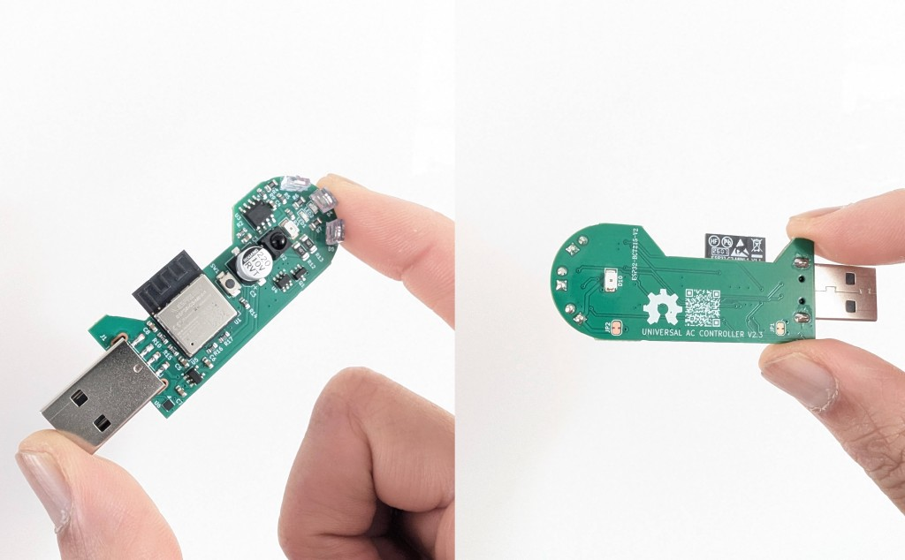
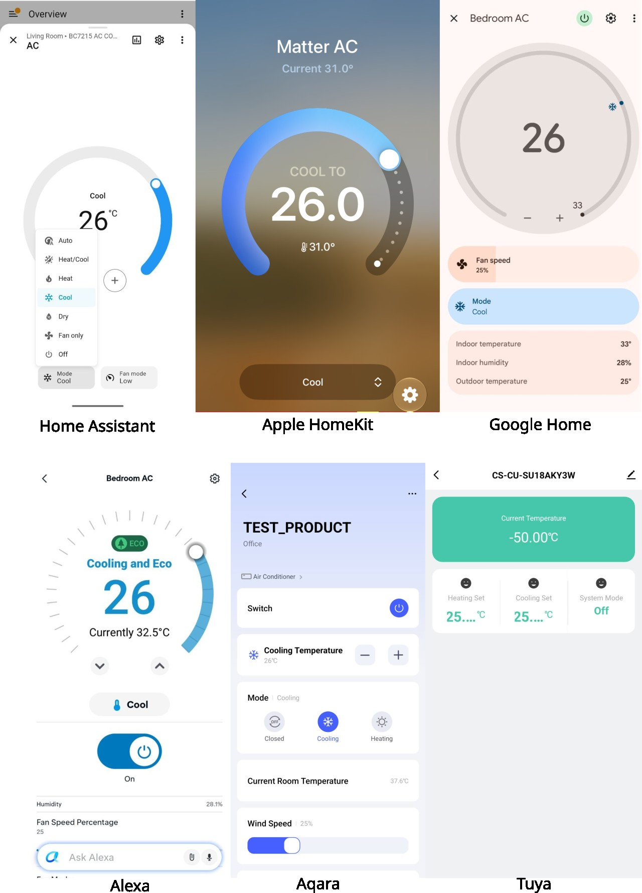
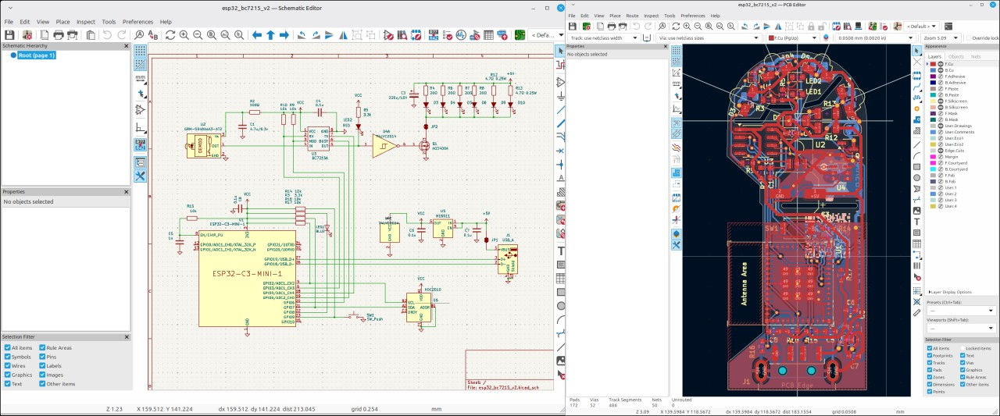
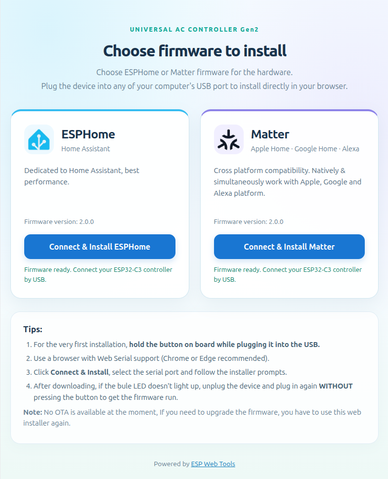

# ESP32-BC7215 Universal AC Controller Gen2 (For Home Assistant & Matter)

Quick jump to:   

[Key Features](#key-features)

[PCB design files](#pcb-design-files)  

[Firmware Installation](#firmware-installation)   

[Setup](#setup)  

[Usage](#usage)   

[LED Status Indicators](#led-status-indicators)

## Introduction

Thanks to so many of you who support my previous projects [Universal A/C IR Control For Home Assistant](https://github.com/timj-code/bc7215_ac_esphome) and [Matter Protocol Air Conditioner Controller for Any Brand](https://github.com/timj-code/bc7215_ac_matter) , they have over 350 stars on Github in total at the time this article was written. Finally I decide to take it one step further to make a dedicated PCB for it so it can be much easier to use and works much better as it has better WiFi reception and 360° IR emitting. A temperature/humidity sensor is added too so you can also see real time environment readings.

**1 device works natively with all the platforms, no bridge required :**

I'll keep the whole project open sourced, **both software and hardware!** PCB design files are included in the repository so you can modify it to your needs and make your own or even put it to batch production. For those who doesn't want to bother making PCBs, I opened a small online store so you can order it from me directly. The link is at the bottom of this article.

## Key Features

- **Offline support for 1200+ AC brands world wide, thousands of models** [full brand list](https://github.com/bitcode-tech/bc7215_ac_lib/blob/master/docs/supported_ac_brand_list_en.pdf)
- **Plug into any USB port (charger) and go, 360° IR emitting**
- **Natively work with Home Assistant, Apple Home Kit, Google Home,  Alexa, Aqara & Tuya**
- **Temperature & Humidity Sensor**
- **No App installation, No account registration**
- **One-press pairing with all AC brands and models**
- **Control ACs with your phone or voice, and also reflect your operation on the original IR remote to the phone**
- **Install firmware with your web browser, no development tools and experience required**

## Duo Firmware

The project provides 2 firmware options: ESPHome version for Home Assistant and Matter version for broad compatibility that works with all platforms: Home Assistant, Apple Home, Google Home, Alexa, Aqara and Tuya.

ESPHome version has most complecated features and will work seamlessly with Home Assistant, but need user to have Home Assistant environment setup at home. Although the Matter version can also work with Home Assistant, if you already have HA at home, it's strongly suggested to use the ESPHome version.

Matter is a new IoT protocol aims to work across different brands and platforms, but the AC support is still limited now and it's currently more adapted to the HVAC systems rather than split-system units, for example, the AUTO mode in Matter protocol defines a temperature range rather than a single target temperature -- which is used in almost all the mini split systems, so the Matter version of this project will only have Heating and Cooling 2 working modes, in comparison in the ESPHome version you can have all the 5 working modes: Auto, Heating, Cooling, Drying, and Fan Only.

#### Matter Protocol Limitations

| Item                   | Conventional Split-System Air Conditioner                                                         | Matter Protocol                                                                                                                                                       |
| ---------------------- | ------------------------------------------------------------------------------------------------- | --------------------------------------------------------------------------------------------------------------------------------------------------------------------- |
| Temperature control    | A single target temperature                                                                       | Separate cooling and heating target temperatures. In Auto mode in particular, a temperature range is set instead of a single target temperature.                      |
| Temperature resolution | Usually 1°C. The AC control library used in this project also supports integer temperatures only. | The device cannot specify the temperature adjustment step through the protocol. Apple, Google & Alexa currently all use 0.5°C as the minimum adjustment step.         |
| Fan control            | Usually four levels: Auto, High, Medium, and Low                                                  | The protocol supports both discrete fan levels and percentage-based control, but smartphone vendors currently appear to support only percentage-based fan adjustment. |

Further more, the user experience of a Matter device is platform specific. Matter is just a communication protocol but how and to what degree it's implemented is the choice of vendor. You'll have different user interfaces on your iPhone and Android, even different features. For example, in Apple Home, environment humidity will not be shown at all.

You have the option to install either of the ESPHome or Matter version, and you can re-flash the device to switch between them at any time. Choose your best fit. Below is a comparison table of the 2 systems and different platforms:

| Platform                               | ESPHome Version                                                                                                                            | Matter Version                                                                          |
| -------------------------------------- | ------------------------------------------------------------------------------------------------------------------------------------------ | --------------------------------------------------------------------------------------- |
| Requirements                           | 2.4GHz Wifi, Home Assistant setup                                                                                                          | 2.4GHz WiFi, IPV6 enabled on LAN                                                        |
| Home Assistant                         | Native support, best performance, extra user defined button to control a function of your choice (such as swing), works locally & remotely | Matter plug-in must be installed, Heating & Cooling mode only, works locally & remotely |
| iPhone alone                           | n/a                                                                                                                                        | Works with Apple Home, Siri, controls your AC locally,(Phone must be at home)           |
| iPhone with Home Pod or Apple TV       | n/a                                                                                                                                        | Can control your AC remotely                                                            |
| Android phone alone                    | n/a                                                                                                                                        | n/a                                                                                     |
| Android phone with Google Nest devices | n/a                                                                                                                                        | Works with Google Home, Google Assistant, Controls your AC locally & remotely           |
| Phone with Alexa devices               | n/a                                                                                                                                        | Works with Alexa, controls your AC locally & remotely                                   |
| Phone with Aqara App along             | n/a                                                                                                                                        | n/a                                                                                     |
| Phone with Aqara  App + Aqara Hub      | n/a                                                                                                                                        | Works with Aqara, locally & remotely                                                    |
| Phone with Tuya App                    | n/a                                                                                                                                        | Works with Tuya locally, no fan control, environment temp not shown correctly           |
| Phone with Tuya App + Tuya Hub         | n/a                                                                                                                                        | Works with Tuya locally & remotely                                                      |

** Other platforms have not been tested. If you have tested this device with other platforms such as Samsung, please let me know the result.

## PCB Design Files

As an open source hardware, schematics including part numbers and PCB layout files are all included in the repository, you can find them in the `pcb` folder. Files are in KiCAD V10 format. A pdf version of the schematic is also in there.

## Firmware Installation

1. ### Web Install (Recommended)

   

   A web installer is setup with Github Pages, Plug this device in your computer and firmware can be installed using your web browser. On the page you can choose which firmware you would install.

   For the very first install, as there is no firmware present, you will need to hold the button pressed while plugging in, once any version of the firmware has been installed, downloading can be done without pushing the button.

   ##### [Web Installer Page](https://timj-code.github.io/universal_ac_controller)

2. ### Clone and Compile (Custom code)

   This method allows you to modify the code to suit your special needs. 

   #### Step 1: Clone the project

   Because this project relies on git submodules (the AC control library and examples from [BC7215A Offline Air Conditioner Control Library](https://github.com/bitcode-tech/bc7215_ac_lib), **do not download it as a ZIP file**. You must use the `git clone --recursive` command to fetch all required dependencies:

   `git clone --recursive https://github.com/timj-code/universal_ac_controller.git`

   #### Step 2: Compile & Install

   Go to the `esphome` or `matter` folder to compile, assuming you already have the ESPHome or ESP-IDF Matter SDK installed.

   For ESPHome:  `esphome compile bc7215_ac_control.yaml`

   for Matter: `idf.py build`

## Setup

Whether for ESPHome or Matter version, there are 2 things need to be setup: 

1. Pair with your AC
2. Network connection

### Pairing with AC

The method is unified for both the ESPHome and Matter version, and it's extremely simple: 

1. Press the button on device, the blue LED will start blink quickly
2. With the original IR remote set to "Cooling mode, 25°C", press "Fan Speed" button towards this device, the LED will stop fast blinking, meaning the pairing is done.

This simple operation will pair 99% of the ACs on market, If your AC falls in the 1%, see below for the advanced pairing method.

You can re-pair the device with any other AC unit at any time, but only one can be paired with (controlled) for each device.

### Setup Connection

This part is different for ESPHome and Matter.

#### ESPHome

After downloading, you'll see prompt to setup WiFi connection in your browser. If that didn't work for any reason, a drop back method is to use the device's WiFi hot spot. 

At power up, if the WiFi connection is not configured yet, the device will enter AP mode. Using your phone, search WiFi hotspot named "BC7215_AC_CONTROLLER-xxxxx" and connect to it, the hotspot doesn't have password, once connected, just follow the screen prompt to choose which WiFi to connect and setup the WiFi password.

#### Matter

Since ESP32 only supports 2.4GHz, it's better to connect your phone to 2.4G Wifi too to prevent potential problems. Also as a requirement of Matter protocol, you must have IPV6 enabled for your LAN. You don't need an IPV6 public IP, but it must be enabled for the local network.

Open the Apple Home or Google Home app. In Apple Home, select **Add Accessory**. In Google Home, select the option to add a device. A QR-code scanning screen will appear. Scan the Matter commissioning QR code. Follow the on-screen instructions to complete the setup. During the connection process, including reconnection after the device has been powered off, the LED will flash slowly to indicate that a connection is being in negotiation. 

Matter commissioning QR code:

During phone setup, you will see a warning stating that this is an **uncertified device**. This is because commercial manufacturers must buy certification to have a unique device certification code. This project uses a test certificate, you will see the warning, but the functionalities will not be restricted.

##### Adding Another Matter Controller

A Matter device can be added to multiple controllers. For example, it can be controlled by both Apple Home and Google Home. It cannot be added directly to another controller. The adding must first be authorised from a phone that is already connected. In Apple Home, this option is shown as **Turn On Pairing Mode**. In Google Home, it is called **Link apps and services**. Selecting it provides a numeric setup code that can be used to add the device on a second platform. 

**Known issues:** In my experience, scanning a QR code usually does not work when adding another controller; the setup-code option is more reliable. Also if you want to use both iPhone & Android as controllers, connect with Android first, otherwise it could fail to add.

### Advanced Pairing Setup

According to the documentation of the AC control library, a few rare protocols cannot be automatically matched through the standard pairing process. If you have confirmed that your pairing procedure is correct but pairing still fails—or if the status shows paired but the AC does not respond correctly—you can try double-clicking the button to cycle through and test the built-in special AC protocols one by one. You can enter the special protocol test mode by double-clicking the button, regardless of whether the device is currently paired or unpaired.

Once in test mode, each double-click will switch to the next built-in special protocol and simultaneously emit a test signal. Make sure the IR can be received by your air conditioner. If your AC responds to a protocol (typically with a beep), that protocol is likely the right one for your unit. You can then verify it by adjusting the temperature via your phone. Controlling by phone will let the device exit this test mode.

During testing, the LED will remain off and only flash when switching protocols; the number of flashes indicates the protocol index number. Once all built-in protocols (currently fewer than 10) have been cycled through, the LED status will return to the "AC Not Paired" state.

### Factory Reset The Device

Press and hold the device button for five seconds. Release it when the blue LED begins flashing rapidly. This will delete all network configuration and AC pairing information.

## Usage

Once the network is configured, the device can be found in Home Assistant or your Apple/Google Home App. Using of the App is usually straight forward. Comparing to the old project using off-the-shelf modules with only 1 IR LED, this device have 6 IR LEDs and can emit IR to 360° around, so basically you can plug it in any USB port available around the room, of course a straight sight of the AC unit from the device's position will work the best.

What you need to pay attention is if you want to keep using the original IR remote and sync your operation to the phone, it's better to place the device somewhere near the AC unit so it can pick up the IR signal from your remote too.

### User Defined Button in Home Assistant

The basic code can let you control the most frequently used Temperature, Mode and Fan Speed of the AC, however, there are many other functions on the AC, the user button will let you to control an extra function of your choice, for example "Swing" or "Sleep" etc.

##### How Does it work?

Unlike the IR for an A/V device, the IR for the AC contains all the control information in a single IR frame. In the pairing step, the ESP32 stores an IR frame as the 'base', then when you change settings, the code will edit the corresponding part of the base to generate a new IR signal. The control for 'Swing' or 'Sleep' was already in there, but kept unchanged. 

The user button let you to record an extra IR frame with the desired control information in and use it to replace the normal 'base' when you want to control that function.

##### Steps:

1. Pair the device with AC as usual, but keep in mind you are going to setup the "User Button" later, so let the extra function be "OFF" when you do the pairing. We'll use 'Swing' as example below.

2. Press "**Learn User Function**" in Home Assistant, the text area will show "**User function learning: press the desired button on the AC remote.**"

3. Press the 'Swing' button on the remote, after this, the 'Swing' function will be "ON" on the remote, and you finished the configuration.

4. When you want to turn the swing on, you press the "User Button" in Home Assistant, and the swing will keep "ON" no matter what Temperature or Mode your set until you press the "User Button" again.

##### Tips & Cautions

1. The title of the button in Home Assistant can be changed, so you can change the "User Button" to a more meaningful name.

2. You can let it control more than 1 function if you like, for example, if there are both "Swing horizontally" and "Swing Vertically" functions, you can control them simultaneously by setting them both OFF and ON during setup.

3. As ESP32 will keep listening to the IR and replace the base to sync status with the remote, if you operated the "User Button" controlled function from the remote, you must change it back by the remote too, otherwise the working base and the base stored with user button will be the same, and this will make the button looks like stop working.

**Note:** *In Matter platforms, though the AC unit will almost respond instantly, sometimes there will be delay between your operation and the status can be shown on your phone, for example, when you turn the AC from OFF to Cool mode on the phone, the AC starts working immediately, but your phone will keep showing an "OFF" in the center of the temperature dial for a while. I observed this happening more often in Google Home than Apple Home. Status will be updated immediately if you exit and open the control card again. This is out of the control of this project.* 

## LED Status Indicators

**Red LED**: IR transmitting indicator

| Blue LED Behaviour           | Meaning                                                                             |
| ---------------------------- | ----------------------------------------------------------------------------------- |
| Steadily on                  | Factory state; the device has not yet been configured.                              |
| Steadily off                 | Not powered or button double clicked (see above)                                    |
| Rapid flashing               | Waiting to receive an infrared signal for air conditioner pairing.                  |
| Slow flashing                | Establishing a network connection.                                                  |
| One short flash per second   | The network is configured, but the air conditioner has not yet been paired.         |
| Two short flashes per second | The air conditioner is paired and the device is waiting to be connected to network. |
| Breathing                    | Pairing and connection are complete; the device is in standby mode.                 |

## Online Shop

eBay: https://ebay.io/m/6YApll

Taobao: https://item.taobao.com/item.htm?ft=t&id=1101425747193

Tindie: https://www.tindie.com/products/44816/

Australian & NZ orders will be shipped from Australia, other orders will ship from China.
